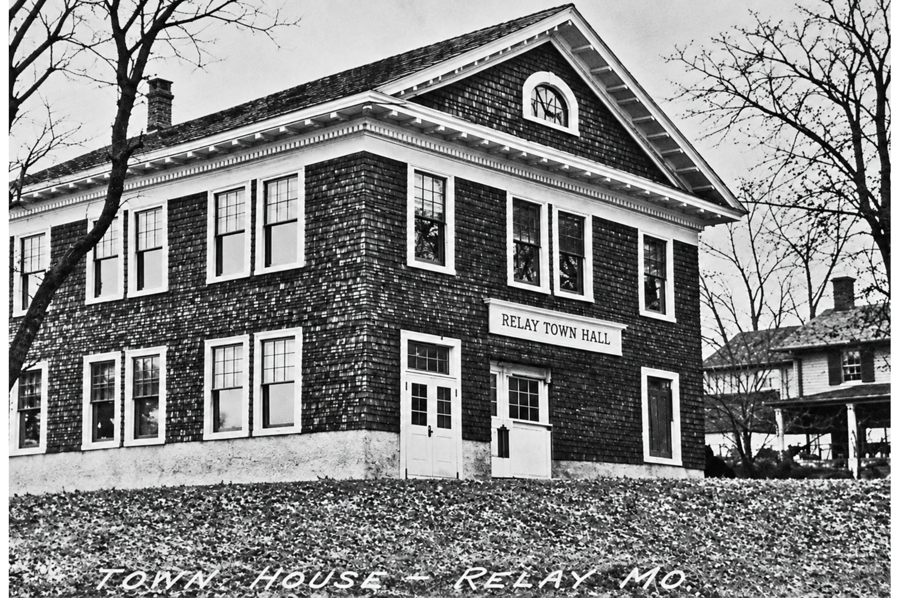
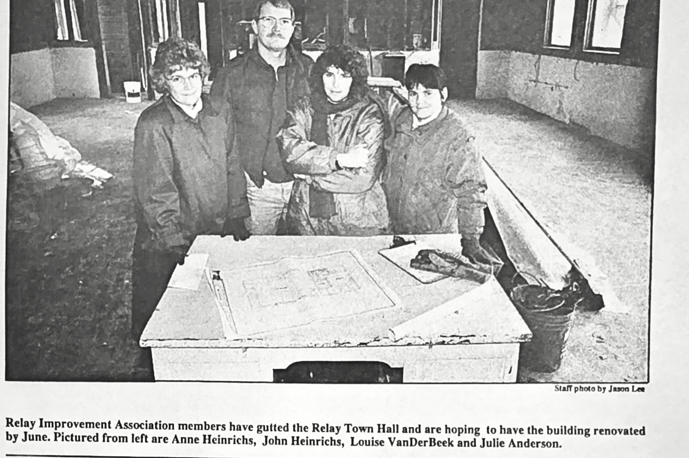

Relay and St. Denis are something special. Surrounded by the suburbs of Baltimore, we have remained a small village with a strong sense of community. And for more than a century, the Relay Town Hall has stood at the heart of it.

As *The Argus and Baltimore Countian* noted decades ago, the Town Hall has always been the center of community life and activity—hosting everything from our volunteer fire department's roots and historic Relay Day celebrations to quarterly RIA meetings, celebrations, and gatherings in times of sorrow.

### Our Turn to Preserve History

The Town Hall was preserved for us by generations of neighbors who raised funds through Relay Day celebrations, Victorian Teas, history talks, and club donations. Members of the Grandfathers Club, Relay Women's Club, and neighbors who tackled major renovations in the 1990s left us a cherished landmark.

Now, it is our turn to carry that work forward.

Like our own homes, the Town Hall faces rising costs for utilities, fuel, building supplies, and ongoing maintenance.

### How to Support

This GivingTuesday (December 1, 2026), please consider making a contribution to the **Relay Town Hall Maintenance Fund**. Your gift will directly cover planned upkeep and unexpected repairs, ensuring the hall remains ready to serve our community for years to come.

- **Donate online:** [Visit our CheddarUp page to contribute](https://ria-giving-tuesday-2026.cheddarup.com)
- **By mail:** Send checks payable to "Relay Improvement Association" to P.O. Box 24046, Relay, MD 21227.

Thank you for your dedication to Relay and St. Denis!

— Relay Improvement Association
